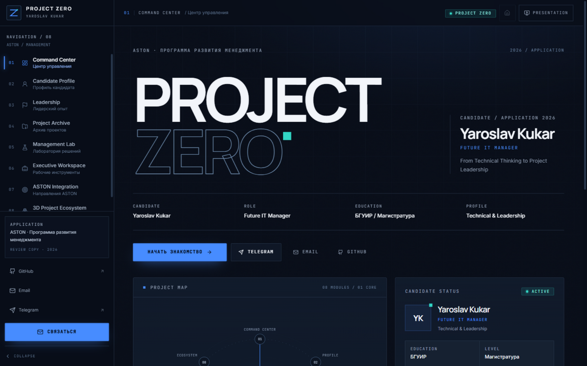
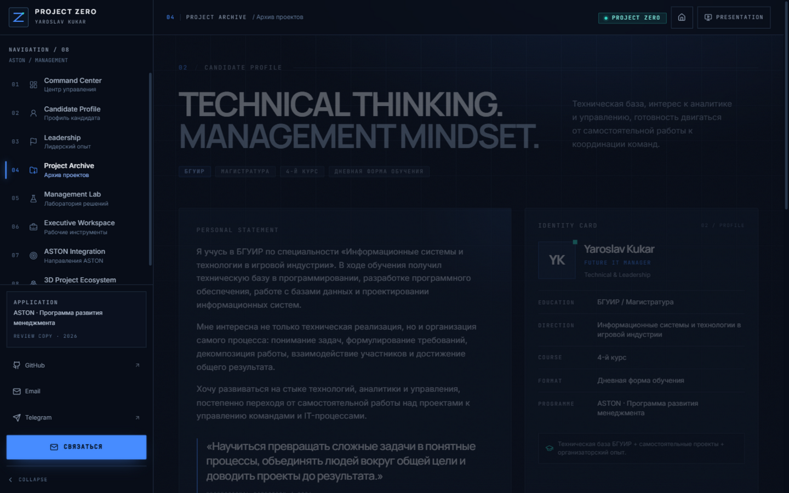
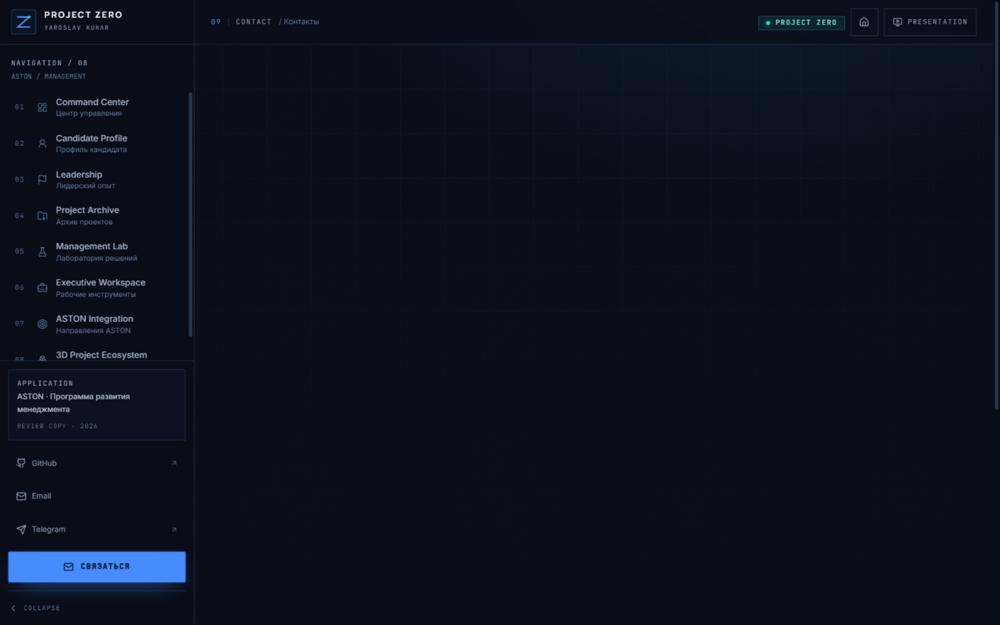
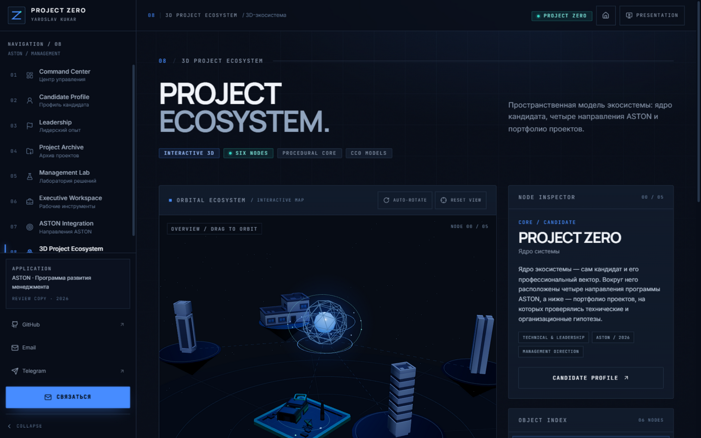

# PROJECT ZERO

Интерактивное одностраничное портфолио **Ярослава Кукара** для программы развития менеджмента **ASTON**. Не набор статичных слайдов, а рабочая среда кандидата: карта системы, профиль, лидерский опыт, проектные досье, управленческие сценарии, рабочий стол, интеграция с направлениями ASTON и пространственная 3D-экосистема.

**Позиционирование:** от технического мышления — к управлению IT-проектами.

**Живая версия:** [kerarty.github.io/CV_Aston](https://kerarty.github.io/CV_Aston/)

---

## Скриншоты

| Command Center | Candidate Profile |
| --- | --- |
|  |  |
| **Project Archive** | **Management Lab** |
|  |  |
| **Contact** | **3D Project Ecosystem** |
|  |  |

---

## Что внутри

| № | Раздел | Содержание |
| --- | --- | --- |
| 01 | Command Center | Главный экран и интерактивная карта восьми модулей |
| 02 | Candidate Profile | Образование, техническая база, интересы, подход |
| 03 | Leadership | Организаторский опыт студенческого совета |
| 04 | Project Archive | Factory Management, Runner, технические проекты |
| 05 | Management Lab | Разбор управленческих сценариев без «правильных ответов» |
| 06 | Executive Workspace | Рабочий стол кандидата и инструменты |
| 07 | ASTON Integration | Соотнесение с Delivery, Operations, Sales & Marketing, People |
| 08 | 3D Project Ecosystem | Интерактивная сцена: ядро, направления ASTON, портфолио |
| 09 | Final Message | `BUILDING SYSTEMS. CONNECTING PEOPLE. DELIVERING RESULTS.` |

Дополнительно: режим презентации, адаптивная навигация, reduced-motion, клавиатурная доступность, WebGL-fallback и 2D-схема экосистемы.

## Стек

- **React 19 + TypeScript + Vite**
- **Tailwind CSS 4** — дизайн-токены и адаптивная сетка
- **Framer Motion** — переходы между разделами
- **GSAP** — сценарная анимация 3D-раскрытия
- **Three.js + React Three Fiber + Drei** — 3D-экосистема
- **React Router (HashRouter)** — навигация, совместимая с GitHub Pages
- **Lucide React** — иконки

## Дизайн-система

| Токен | Значение |
| --- | --- |
| Background | `#080D18` |
| Panels | `#111B2B` / `#19263A` |
| Accent | `#478CFF` |
| Teal | `#32D6C5` |
| Text | `#F2F5FA` |
| Muted | `#8C9AAF` |
| Lines | `#27364B` |

Типографика: **Manrope** для дисплея, **Inter** для текста, **JetBrains Mono** для технических подписей. Визуальный язык — швейцарская сетка и mission-control, без «киберпанка» и игровых клише.

## Локальный запуск

```bash
npm install
npm run dev
```

Проверка типов и production-сборка:

```bash
npm run typecheck
npm run build
npm run preview
```

## Публикация на GitHub Pages

Сайт публикуется автоматически: каждый пуш в `main` проходит typecheck, ESLint и production-сборку, затем workflow публикует `dist`. Живая версия — [kerarty.github.io/CV_Aston](https://kerarty.github.io/CV_Aston/).

В репозитории уже есть workflow `.github/workflows/deploy.yml`:

1. Создайте репозиторий на GitHub и запушьте проект в ветку `main`.
2. В настройках репозитория: **Settings → Pages → Source → GitHub Actions**.
3. Workflow соберёт проект и опубликует `dist`.

По умолчанию production-сборка использует base `/CV_Aston/`. Workflow передаёт актуальное имя репозитория через `VITE_BASE`. Для локальной сборки под другой путь:

```bash
# PowerShell
$env:VITE_BASE="/my-repo/"; npm run build
```

Для пользовательского сайта `username.github.io` задайте `VITE_BASE="/"`.

## 3D-экосистема

Сцена загружается лениво и только в разделе `#/ecosystem`. Ядро, орбиты, платформы, связи и трасса Portfolio Island построены процедурно; архитектурные модели — готовые CC0-ассеты, очищенные и оптимизированные в GLB. Все материалы перенастроены под палитру проекта.

- **Kenney City Kit (Commercial)** — четыре модуля направлений ASTON: Delivery, Operations, Sales & Marketing, People.
- **Kenney Space Kit** — Portfolio Island: платформа, ангар, труба, антенна, техническая структура.

Источники: [kenney.nl/assets/city-kit-commercial](https://kenney.nl/assets/city-kit-commercial), [kenney.nl/assets/space-kit](https://kenney.nl/assets/space-kit). Лицензия **CC0 1.0 Universal** — ассеты можно использовать в личных и коммерческих проектах без указания авторства; кредиты добавлены из уважения к автору.

Если WebGL недоступен или сцена падает, показывается интерактивная SVG-схема с теми же узлами и переходами. Выбор объектов доступен и через DOM-список, поэтому раздел остаётся полностью навигируемым без 3D.

## Структура проекта

```text
src/
  app/            # роутер, навигация, оболочка приложения
  components/     # layout, UI-примитивы, анимации
  data/           # проверенные данные кандидата и контент разделов
  hooks/          # media query / reduced motion
  sections/       # девять экранов портфолио
  three/          # сцена, узлы, материалы
  styles/         # дизайн-токены и глобальные стили
public/
  assets/models/  # оптимизированные GLB, CC0
  og.jpg          # Open Graph 1200×630
```

## Данные и честность контента

- Используются только проверяемые сведения об образовании, учебных проектах и организаторском опыте.
- Нет вымышленных KPI, процентов, рейтингов, коммерческого опыта или метрик студенческого совета.
- Публичные контакты: GitHub, email и Telegram. CV-файл пока не приложен — кнопка «Скачать CV» скрыта.
- Уровень английского и доступность не указаны.
- Проект не является официальным продуктом ASTON.

## Лицензии

Код проекта распространяется без отдельной лицензии; перед публикацией добавьте выбранную лицензию при необходимости. 3D-модели — **CC0 1.0** (Kenney). Шрифты — **SIL Open Font License** (Inter, Manrope, JetBrains Mono).
